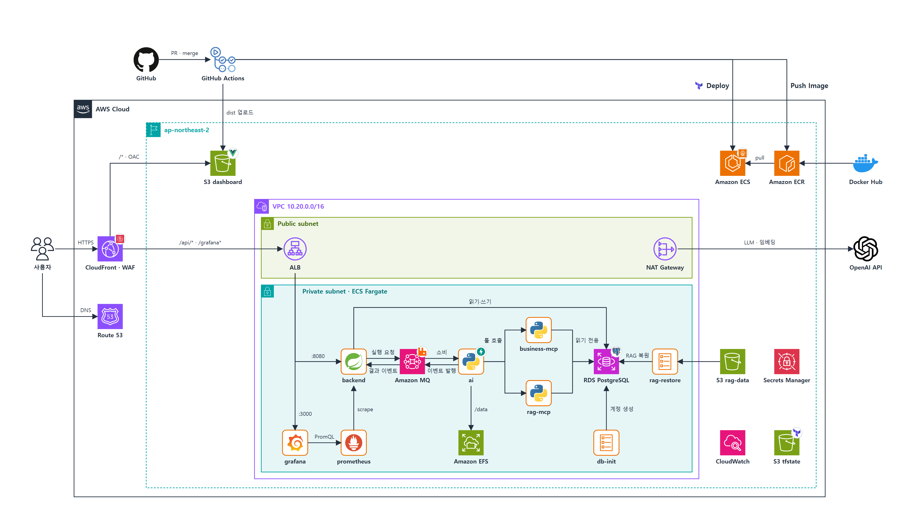

# AWS 아키텍처 다이어그램

[infra](https://github.com/mro-agent-proj/infra) 레포 Terraform으로 정의한 최종 배포 구성입니다.



| 파일 | 내용 |
| --- | --- |
| `aws-architecture.png` | 보고서·발표용 이미지 (4000×2280) |
| `aws-architecture.html` | 원본. 브라우저로 열면 확대해도 선명합니다 (아이콘 내장, 글꼴만 Google Fonts) |
| `source/build_diagram.py` | 생성 스크립트. 좌표·연결선이 코드로 정의되어 있습니다 |

## 읽는 법

- **요청 처리:** 사용자 → CloudFront(WAF) → ALB → backend → Amazon MQ → ai → business-mcp / rag-mcp → RDS
- **배포:** GitHub Actions가 이미지를 ECR에 올리고(Push Image), infra 레포에서만 `terraform apply`로 ECS에 배포(Deploy)
- **1회성 작업:** db-init(DB 계정), rag-restore(S3 rag-data → RDS)
- 주황 테두리는 ECS Fargate 서비스, 작은 원은 그 위에서 쓰는 기술입니다.

기준: infra 레포 `fd0e8e4` 이후 구성 (2026-10-26). 아직 AWS에 배포하지 않았고 `terraform validate`까지 확인한 정의입니다.

## 다시 만들기

구성이 바뀌면 `source/build_diagram.py`의 좌표·연결선을 고친 뒤 다시 생성합니다.

```bash
# 아이콘 패키지를 받을 빈 작업 폴더 (예: work/)
mkdir -p work/dl-aws work/dl-logos
curl -sL "$(npm view aws-icons@3.3.0 dist.tarball)" | tar -xz -C work/dl-aws
curl -sL "$(npm view @iconify-json/logos dist.tarball)" | tar -xz -C work/dl-logos
python source/build_diagram.py work        # → work/mro-architecture.html
```

PNG는 HTML을 브라우저로 열어 캡처하거나 헤드리스 브라우저로 만듭니다
(예: `msedge --headless=new --force-device-scale-factor=2 --window-size=2000,1140 --screenshot=aws-architecture.png <HTML 경로>`).

아이콘 출처: [AWS Architecture Icons](https://aws.amazon.com/architecture/icons/)(aws-icons 패키지), 기술 로고는 [gilbarbara/logos](https://github.com/gilbarbara/logos)(@iconify-json/logos, CC0). 각 로고는 해당 프로젝트·회사의 상표입니다.
