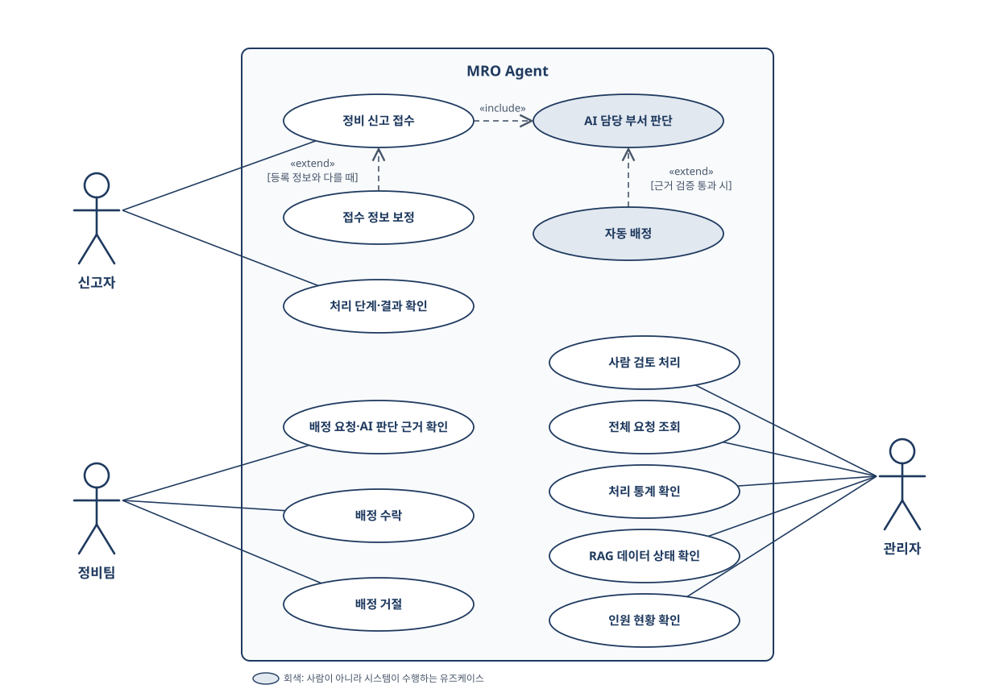
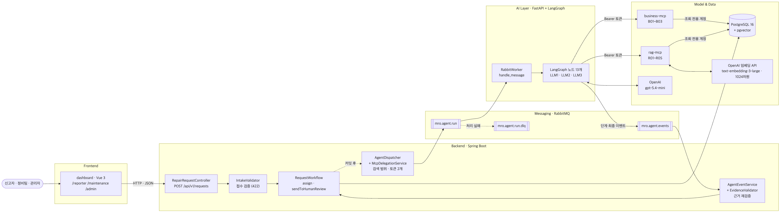
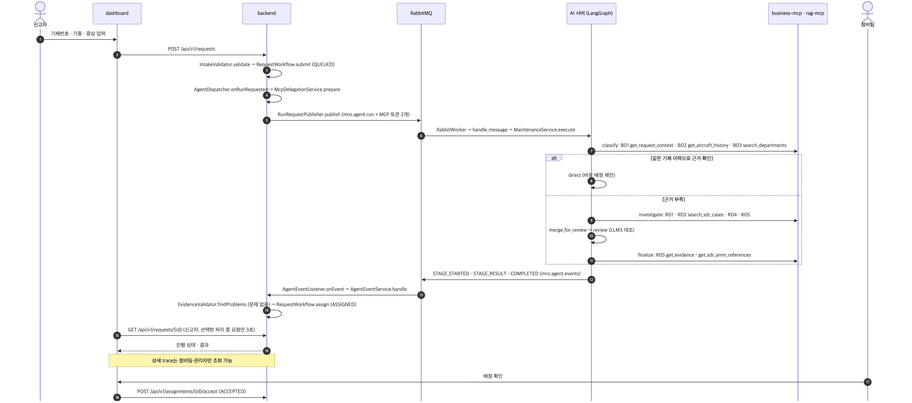
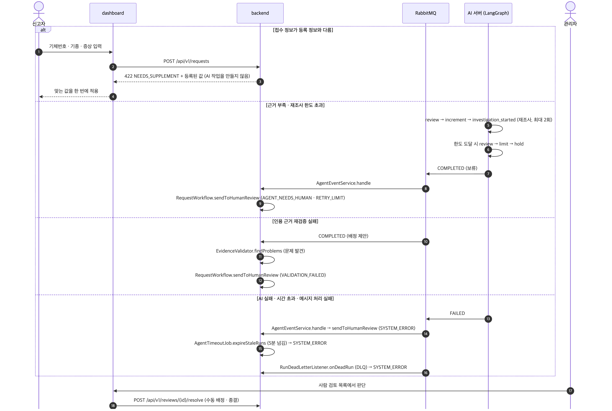
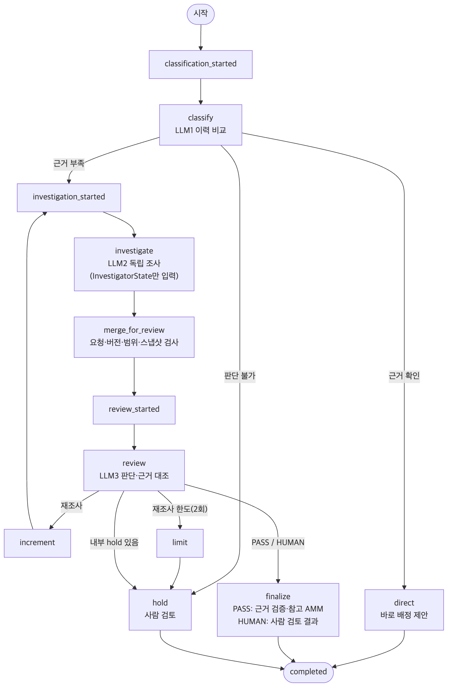

# 아키텍처 설계서

항공기 정비요청 Agent의 MVP, 문제 정의, 구성도, 처리 흐름(정상·실패), LangGraph 노드 흐름, MCP 도구를 한 문서로 정리했습니다.
화살표와 노드 이름은 실제 코드의 엔드포인트·클래스·메서드·큐·LangGraph 노드 이름과 같습니다 (2026-10-26 각 레포 main 기준).

| 구성 | 코드 위치 |
|:--|:--|
| API·접수 검증·배정 | [backend](https://github.com/mro-agent-proj/backend) `domain/request`, `domain/agent`, `domain/assignment` |
| AI 실행·그래프 | [LLM](https://github.com/mro-agent-proj/LLM) `app/server/rabbit.py`, `app/service.py`, `app/agent/full_workflow.py` |
| MCP 도구 | [agent](https://github.com/mro-agent-proj/agent) `src/mro_mcp/business`, `src/mro_mcp/rag` |

## 이번 프로젝트의 MVP

핵심 가치 하나를 끝까지 동작하게 만드는 것이 목표였습니다.

| | 항목 | 이 프로젝트에서 |
|:--:|:--|:--|
| **1** | **가치를 한 문장으로** | 정비 신고를 **근거와 함께** 담당 정비팀에 바로 배정한다 |
| **2** | **그 가치가 끝까지 동작** | 신고 접수 → AI 분류·조사·검토 → 근거 재검증 → 정비팀 배정 화면 |
| **3** | **숫자로 확인** | 서비스 평가 200건 (dev 80 / test 120): 자동배정 정밀도, LLM2 부서 일치율, 시스템 오류 수 |
| **4** | **모를 때는 멈춤** | 근거가 없거나 검증에 실패하면 자동 배정하지 않고 사람 검토로. 배정 화면에 인용 근거 표시 |
| **5** | **나머지는 뒤로** | AWS 실배포(Terraform 정의까지), AI 워커 여러 개로 확장, 인원 현황의 배정 반영 |

 

## 문제와 AI 적용 지점

| 항목 | 내용 |
|:--|:--|
| **비즈니스 문제** | 정비 신고마다 사람이 증상을 읽고 과거 사례를 찾아 담당 부서를 정해야 해서, 분류에 시간이 들고 담당자마다 판단이 달라짐 |
| **대상 사용자** | 신고자(항공사 정비 요청자), 정비팀(부서 8개), 관리자 |
| **유저 문제** | 신고자는 누가 언제 처리하는지 모르고, 정비팀은 왜 우리 팀에 왔는지 근거를 다시 찾아야 하며, 관리자는 애매한 건만 골라 보기 어려움 |
| **AI 적용 지점** | 증상 → ATA 계통 분류(LLM1), 같은 기체 이력·SDR 사례·기술자료 검색(MCP + RAG), 판단 대조(LLM3). 근거가 없으면 사람 검토로 |
| **핵심 시나리오** | 신고 접수 → 기체·기종 검증 → AI 분류·조사·검토 → 근거 재검증 → 정비팀 배정 → 수락 |
| **데이터** | FAA 공개 SDR 71,741건, JASC 548개, AMM 참조 35,396건, Airbus Safety First 61편 + 시연용 업무 시드(기체 20, 수리이력 1,600). 계정은 시연용 `.test` 주소뿐이고 실제 개인정보 없음 |
| **성공 지표** | 서비스 평가 200건의 자동배정 정밀도·오배정률·사람 검토 비율, 시스템 오류·시간 초과 0건 |

 

## 유즈케이스

로그인·회원가입처럼 모든 사용자에게 공통인 기능은 빼고, 세 액터의 업무만 담았습니다. UML 표기(연관 실선, «include», «extend»)만 쓰고, 업무 순서는 아래 처리 흐름에서 다룹니다.

| 액터 | 유즈케이스 | 화면 | API |
|:--|:--|:--|:--|
| **신고자** | 정비 신고 접수 | `/reporter` | `POST /api/v1/requests` |
| | 접수 정보 보정 | `/reporter` | 422 `NEEDS_SUPPLEMENT` 응답의 등록 값을 한 번에 적용 |
| | 처리 단계·결과 확인 | `/reporter` | `GET /api/v1/requests`, `GET /api/v1/requests/{id}` (목록 15초, 선택한 처리 중 요청 3초 갱신) |
| **정비팀** | 배정 요청·AI 판단 근거 확인 | `/maintenance` | `GET /api/v1/assignments`, `GET /api/v1/requests/{id}/trace` |
| | 배정 수락 | `/maintenance` | `POST /api/v1/assignments/{id}/accept` |
| | 배정 거절 (사유 입력) | `/maintenance` | `POST /api/v1/assignments/{id}/reject` → 사람 검토 `TEAM_REJECTED` |
| **관리자** | 사람 검토 처리 | `/admin` | `GET /api/v1/reviews`, `POST /api/v1/reviews/{id}/resolve` (`ASSIGN` 수동 배정 · `CLOSE` 종결) |
| | 전체 요청 조회 | `/admin` | `GET /api/v1/requests` |
| | 처리 통계 확인 | `/admin` | `GET /api/v1/stats/summary` (자동 배정률 등) |
| | RAG 데이터 상태 확인 | `/admin` | `GET /actuator/health` (ragData) |
| | 인원 현황 확인 | `/admin/staffing` | `GET /api/v1/staffing` |

- **AI 담당 부서 판단**은 신고 접수에 항상 포함되고(«include»), **자동 배정**은 근거 검증을 통과했을 때만 일어납니다(«extend»). 둘 다 사람이 아니라 시스템이 수행합니다.
- AI가 근거를 찾지 못하거나 정비팀이 배정을 거절하면, 요청은 관리자의 **사람 검토 처리** 목록으로 모입니다(처리 흐름: 실패 참고).

 

## 구성도

> **Harness** — MCP 도구 10초·재시도 1회 · 모델 호출 45초 · 단계별 도구 호출 8회 · 재조사 최대 2회 · AI 실행 280초 · 백엔드 처리 한도 5분 · 실행별 MCP 토큰 10분 · LLM 출력 스키마 검증 실패 시 1회 재요청

 

## 처리 흐름: 정상

 

## 처리 흐름: 실패

| 실패 | 어디서 막나 | 결과 |
|:--|:--|:--|
| 접수 정보 불일치 · 필수값 누락 · 타 항공사 기체(FORBIDDEN_AIRLINE) | `IntakeValidator.validate` | 422, AI 실행 안 함 |
| 이력·사례로 근거를 찾지 못함 | LangGraph `hold` | 사람 검토 `AGENT_NEEDS_HUMAN` |
| 재조사 2회로도 충돌이 남음 | LangGraph `limit` → `hold` | 사람 검토 `RETRY_LIMIT` |
| 인용 근거 재검증 실패 | AI 발행 전 검증 또는 Backend `EvidenceValidator.findProblems` | 사람 검토 `VALIDATION_FAILED` |
| 모델·도구 오류, 5분 초과, 메시지 처리 실패 | `FAILED` 이벤트, `AgentTimeoutJob`, `RunDeadLetterListener` | 사람 검토 `SYSTEM_ERROR` |
| 정비팀이 배정을 거절 | `AssignmentService.reject` | 사람 검토 `TEAM_REJECTED` |

 

## LangGraph: AI 판단 흐름

AI 서버는 LangGraph로 판단 단계를 그래프로 연결합니다. 단계마다 상태(State)를 체크포인트에 저장해, 서버가 재시작돼도 멈춘 단계부터 이어 갑니다.

| 노드 | 하는 일 |
|:--|:--|
| `classify` | 증상만 보고 ATA 후보를 고른 뒤, 같은 기체의 수리이력과 비교 (LLM1) |
| `investigate` | LLM1 결론·수리이력을 받지 않고, 원본 신고와 자체 검색 결과만으로 조사 (LLM2) |
| `merge_for_review` | LLM1·LLM2 결과를 합치기 전에 요청·버전·검색 범위·스냅샷이 그대로인지 검사 |
| `review` | 두 판단과 원문을 대조해 통과·재조사·보류를 결정 (LLM3) |
| `finalize` | PASS는 근거 재검증·참고 AMM 첨부, HUMAN은 사람 검토 결과 구성 |
| `hold` | 근거가 부족하거나 재조사 한도를 넘으면 사람 검토로 보냄 |

 

## MCP 도구

AI는 MCP(Model Context Protocol)로 두 서버의 도구 9개를 호출합니다. 두 서버 모두 **읽기 전용**이며, 요청마다 백엔드가 발급한 토큰과 검색 범위 안에서만 조회합니다.

| 서버 | ID | 도구 | 하는 일 | 누가 부르나 |
|:--|:--:|:--|:--|:--|
| business-mcp | B01 | `get_request_context` | 접수 내용과 이 실행에 등록된 검색 범위 | 실행기 (초기 준비·LLM2 독립 컨텍스트 구성·최종 검증) |
| | B02 | `get_aircraft_history` | 같은 기체의 이전 수리이력 (접수 시각 이전만) | LLM1, LLM3, 최종 검증 (LLM2는 차단) |
| | B03 | `search_departments` | 정비 부서 8개와 담당 ATA | 실행기 (단계마다 고정 확인) |
| rag-mcp | R01 | `search_jasc_codes` | JASC 결함 코드 후보와 정의 | LLM2, LLM3 |
| | R02 | `search_sdr_cases` | SDR 사례 71,741건 하이브리드 검색 (단어 + 벡터, 한국어 질의 가능) | LLM2, LLM3 |
| | R03 | `search_amm_references` | AMM 번호로 그 번호가 인용된 SDR 문장 조회 | LLM 도구 목록에서 제외 |
| | R04 | `search_technical_docs` | Airbus Safety First 기술자료 의미 검색 | LLM2, LLM3 |
| | R05 | `get_evidence` | 받은 근거의 원문과 인용 위치 재확인 | LLM2, LLM3, 최종 검증 |
| | 확장 | `get_sdr_amm_references` | 근거 SDR에 인용된 AMM 번호 조회 (참고용 첨부) | 실행기 (AI 판단 완료 후, 결과 이벤트 발행 전) |

> 2026-10-23 서비스 시나리오 200건의 노드별 trace에서 LLM2는 R01을 77회, R02를 84회 골라 썼고, 최종 검증은 R05를 97회 호출했습니다.

 

R02의 기본 검색 범위는 같은 기본 모델·ceo/neo 세대인 `MODEL_GENERATION`입니다. 초기 검색이 부족하면 이유를 남겨 `FAMILY`로 넓힐 수 있고, Backend 허용 목록은 단어·벡터 검색과 R05에 함께 적용됩니다. 정확 모델 `EXACT` 및 미확인 모델의 제한은 유지합니다. 질의 인코더 미설정·SDR 벡터 미준비·임베딩 API 실패 시 R02는 경고와 함께 단어 검색으로 대체합니다. 고정 단어검색 색인 자체가 없거나 비정상이면 오류입니다. 검색 범위 확대는 정비 구성의 동일성을 보증하지 않습니다.

위 도구 수는 HTTP 요청 수나 검색 정확도가 아닙니다. 평가 정의·제약·버전은 [평가 원자료](../evaluations/2026-10-23-isolated-200/README.md)와 [최종 보고서 기준](../final-report/README.md)에 있습니다.
